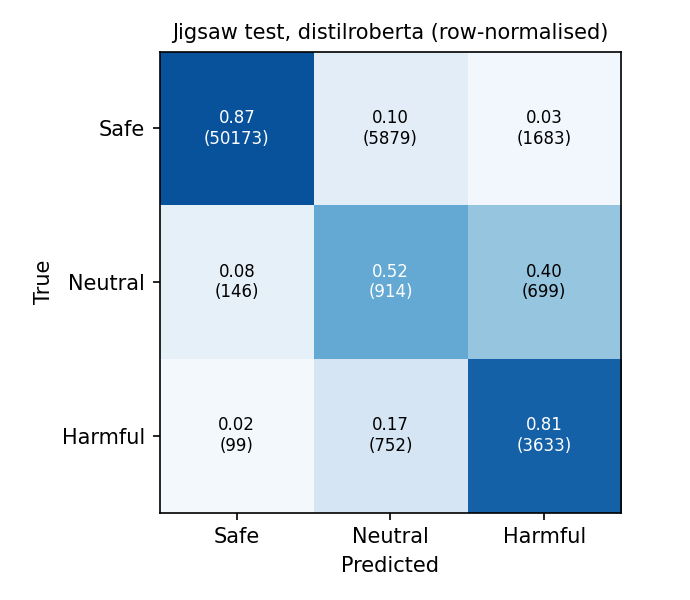
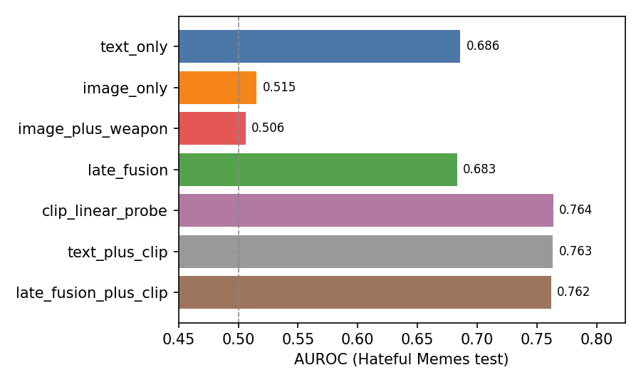
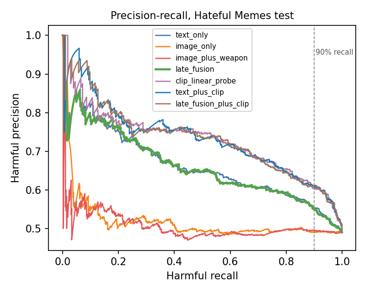
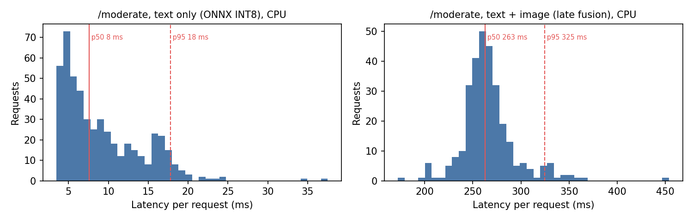

# Multimodal Content Moderation

A text + image moderation service that labels user content **Safe / Neutral / Harmful**, built only on public
data and measured end to end: baselines first, then a fine-tuned transformer, an image classifier, a weapon
detector, fusion of the signals, a recall-first decision threshold, the share of manual review that threshold
would remove, calibration, and CPU latency behind a **FastAPI** service.

`PyTorch` `Hugging Face Transformers` `CLIP` `timm` `YOLOv8` `scikit-learn` `FastAPI` `ONNX Runtime`

```
item (text + image)
 |-- Text branch : clean -> [VADER | TF-IDF + LR] -> fine-tuned DistilRoBERTa        -> p_text
 |-- Image branch: EfficientNet-B0 classifier, CLIP ViT-L/14 probe                    -> p_image, p_clip
 |                 YOLOv8s weapon detector (Handgun, Rifle, Shotgun, Knife)            -> weapon_present, max_conf
 '-- Fusion      : logistic regression on branch scores (chosen on validation)        -> p_harmful
                   two thresholds tuned on validation (Harmful recall >= 90%)          -> Safe / Neutral / Harmful + reasons
FastAPI /moderate -> {label, p_harmful, scores, reasons, latency_ms}
```

Every number below is written by code into [`results/`](results/) and copied into this file by
`python -m scripts.render_readme`. Nothing is typed by hand. One-page summary:
[`results/RESULTS_SUMMARY.md`](results/RESULTS_SUMMARY.md).

## Key findings

1. **A fine-tuned transformer is clearly better where it matters, not everywhere.** On the 64K-comment Jigsaw test
   set DistilRoBERTa raises Harmful F1 from 0.635 (TF-IDF) to 0.692 and Harmful AUROC from 0.967 to 0.976, but
   macro-F1 moves only from 0.590 to 0.606 because the "mild" Neutral class stays near 0.20 F1 for every model:
   the line between rude and harmful is subjective even for annotators. RoBERTa-base adds about one more point of Harmful F1
   for roughly twice the training time. VADER is far behind (Harmful F1 0.264): sentiment is not toxicity.
2. **Transformers transfer better out of domain.** Trained on Wikipedia comments and tested untouched on 1,000
   YouTube comments, DistilRoBERTa keeps a toxic-vs-safe AUROC of 0.856 against 0.804 for TF-IDF.
3. **Score-level fusion of weak branches does not help; a joint embedding does.** On Hateful Memes an ImageNet
   EfficientNet-B0 is near chance (AUROC 0.515) and adding it plus weapon features to the caption model leaves AUROC
   flat (0.683 vs 0.686 text only). CLIP, which embeds the image and the caption in one space, lifts AUROC to
   **0.763**, a gain of 7.7 points over text only. The meaning of a meme lives in how picture and words relate.
4. **The weapon detector works but is the wrong signal for memes.** YOLOv8s reaches mAP50 0.714 on held-out Open
   Images weapons, yet weapons are rare in hateful memes and are not what makes them hateful, so the feature adds
   nothing there. It is still useful as an explanation and as a signal for other content.
5. **Triage: 40.6% of items could skip review, but recall slipped from 90% to 79% on test.** The threshold was
   set on validation for 90% Harmful recall and applied unchanged. The official test split is harder and more
   balanced (49% hateful vs 35% in training, with deliberate "benign confounders"), so recall dropped. Reporting that
   gap is the point: a threshold tuned offline must be re-checked on live traffic before it is trusted.
6. **Calibration breaks under label shift.** The text models are reasonably calibrated (test ECE 0.04 to 0.07), the fusion
   model is not (0.16) because the hateful base rate differs between training and test. Temperature scaling cannot
   fix a prior shift; recalibrating on target-domain labels would.
7. **Fast enough to serve on two CPU cores.** Text requests take 7.6 ms p50 and 17.8 ms p95 with an INT8 ONNX model
   that is 4.9x faster than PyTorch FP32 with no F1 loss. A full text + image request with all branches takes
   263 ms p50.

## Results

### 1. Text: baselines vs fine-tuned transformers (Jigsaw, 3 classes)

<!-- RESULTS:text -->
| Model | Macro-F1 | Harmful F1 | Neutral F1 | Safe F1 | Harmful AUROC | Accuracy |
|---|---|---|---|---|---|---|
| Majority class (always Safe) | 0.316 | 0.000 | 0.000 | 0.949 | n/a | 0.902 |
| VADER compound + thresholds | 0.416 | 0.264 | 0.085 | 0.900 | 0.783 | 0.808 |
| TF-IDF + logistic regression | 0.590 | 0.635 | 0.194 | 0.942 | 0.967 | 0.876 |
| DistilRoBERTa (fine-tuned) | 0.606 | 0.692 | 0.197 | 0.928 | 0.976 | 0.855 |
| RoBERTa-base (fine-tuned) | 0.612 | 0.702 | 0.202 | 0.932 | 0.977 | 0.863 |

Jigsaw official test set, n = 63,978. Source: `results/text_eval.json`.
<!-- /RESULTS:text -->



Macro-F1 averages the three classes equally, so a model that always says Safe scores 90% accuracy but only 0.316
macro-F1 (first row). Harmful AUROC measures ranking quality for the class the threshold acts on.

### 2. Out of domain (trained on Jigsaw, tested without any tuning)

<!-- RESULTS:ood -->
**YouToxic English 1000**

| Model | Macro-F1 | Toxic vs safe AUROC |
|---|---|---|
| TF-IDF + logistic regression | 0.454 | 0.804 |
| DistilRoBERTa (fine-tuned) | 0.472 | 0.856 |
| VADER compound + thresholds | 0.361 | 0.683 |

**Civil Comments test slice (n=5000, seed 42)**

| Model | Macro-F1 | Toxic vs safe AUROC |
|---|---|---|
| TF-IDF + logistic regression | 0.461 | 0.849 |
| DistilRoBERTa (fine-tuned) | 0.460 | 0.916 |
| RoBERTa-base (fine-tuned) | 0.457 | 0.924 |
| VADER compound + thresholds | 0.374 | 0.674 |

Models trained on Jigsaw only, no tuning on these sets. Source: `results/text_ood.json`.
<!-- /RESULTS:ood -->

### 3. Fusion on Hateful Memes (text vs image vs combined)

<!-- RESULTS:fusion -->
| Model | AUROC | Avg. precision | Macro-F1 |
|---|---|---|---|
| Text only (DistilRoBERTa on captions) | 0.686 | 0.661 | 0.605 |
| Image only (EfficientNet-B0) | 0.515 | 0.517 | 0.497 |
| Image + YOLOv8s weapon features | 0.506 | 0.508 | 0.485 |
| Late fusion: text + image + weapon (served by the API) | 0.683 | 0.660 | 0.609 |
| CLIP ViT-L/14 linear probe (image + caption) | 0.764 | 0.727 | 0.687 |
| **Text + CLIP fusion** (selected on validation) | 0.763 | 0.732 | 0.685 |
| Late fusion + CLIP | 0.762 | 0.731 | 0.686 |

Hateful Memes `test_seen.jsonl` (n = 1000), never used for training or selection. The headline model is the one with the best out-of-fold AUROC on the held-out fusion split. Source: `results/fusion_eval.json`.
<!-- /RESULTS:fusion -->



Hateful Memes is built so that neither the caption nor the picture alone is enough (a harmless caption over a
harmless image can be hateful together), which makes it a direct test of whether fusion adds signal. The API
serves the lighter late-fusion model; the CLIP variant is the better model and the next step for serving.

### 4. Weapon detector (Open Images V7 subset, held-out test split)

<!-- RESULTS:detector -->
| mAP50 | mAP50-95 | Precision | Recall |
|---|---|---|---|
| 0.714 | 0.537 | 0.679 | 0.660 |

Per-class mAP50-95: Handgun 0.653, Rifle 0.469, Shotgun 0.351, Knife 0.677. Source: `results/detector_eval.json`.
<!-- /RESULTS:detector -->

### 5. Threshold and triage

<!-- RESULTS:triage -->
| Model | Harmful recall (val) | Harmful recall (test) | Harmful precision (test) | Auto-cleared (test) |
|---|---|---|---|---|
| Text only (DistilRoBERTa on captions) | 90.1% | 79.0% | 59.5% | 35.0% |
| Image only (EfficientNet-B0) | 90.1% | 90.6% | 49.0% | 9.4% |
| Image + YOLOv8s weapon features | 90.1% | 91.0% | 49.3% | 9.6% |
| Late fusion: text + image + weapon (served by the API) | 90.1% | 80.6% | 59.4% | 33.5% |
| CLIP ViT-L/14 linear probe (image + caption) | 90.1% | 78.4% | 65.5% | 41.4% |
| **Text + CLIP fusion** | 90.1% | 79.0% | 65.1% | **40.6%** |
| Late fusion + CLIP | 90.1% | 78.8% | 64.3% | 40.0% |

For the headline model, 40.6% of test items fall below t_clear = 0.207 and would skip review; 25.37% of that cleared pile is actually hateful (base rate 49.0%). Setting the threshold on the test labels themselves to force exactly 90% recall would clear 27.6% (shown only to size the validation-to-test gap). Sources: `results/threshold.json`, `results/triage.json`.
<!-- /RESULTS:triage -->



**Triage metric, defined exactly.** On validation (out-of-fold scores on the held-out fusion split) we pick the
largest threshold `t_clear` whose Harmful recall is at least 90%. On test, every item with `p_harmful < t_clear`
is auto-cleared as Safe and skips human review. `auto_cleared_pct` is the share of test items auto-cleared, which is
the estimated reduction in manual-review volume compared with reviewing everything. The cost is shown next to it:
the recall actually reached on test and the harmful share inside the cleared pile. A second threshold `t_flag`
(precision of at least 0.8 on validation) splits the rest into Harmful (auto-flag) and Neutral (human review).

### 6. Calibration

<!-- RESULTS:calibration -->
| Component | Temperature | Test ECE before | Test ECE after |
|---|---|---|---|
| TF-IDF text model (3-class) | 1.04 | 0.040 | 0.036 |
| DistilRoBERTa (3-class) | 1.15 | 0.062 | 0.053 |
| RoBERTa-base (3-class) | 1.24 | 0.069 | 0.056 |
| Fusion: Text + CLIP fusion | 1.01 | 0.159 | 0.158 |
| Fusion: Late fusion: text + image + weapon (served by the API) | 1.01 | 0.169 | 0.168 |

Source: `results/calibration.json`.
<!-- /RESULTS:calibration -->

Expected calibration error (15 bins) before and after temperature scaling fitted on validation.

### 7. Serving latency on CPU

<!-- RESULTS:latency -->
| Request type | p50 (ms) | p95 (ms) | Throughput (req/s) | Hardware |
|---|---|---|---|---|
| Text only (ONNX INT8 DistilRoBERTa) | 7.6 | 17.8 | 112.4 | Intel(R) Xeon(R) Processor @ 2.10GHz, 2 vCPU |
| Text + image (all branches + late fusion) | 262.8 | 324.7 | 3.8 | Intel(R) Xeon(R) Processor @ 2.10GHz, 2 vCPU |

| Text model on CPU (batch 1) | p50 (ms) | Macro-F1 |
|---|---|---|
| PyTorch FP32 | 28.2 | 0.611 |
| ONNX Runtime INT8 | 5.8 | 0.618 |

INT8 speed-up 4.88x, macro-F1 change +0.0069. Source: `results/onnx.json`.
<!-- /RESULTS:latency -->



One item per request, sequential, after warm-up, measured by the client over HTTP on the same machine.

Failure cases with short analysis: [`results/examples.md`](results/examples.md).

## Data

All public; download steps and licences in [`data/README.md`](data/README.md); versions, hashes and split
sizes in [`results/data_summary.json`](results/data_summary.json).

| Use | Dataset |
|---|---|
| Text training and test | Jigsaw Toxic Comment Classification (159,571 labelled comments; official 63,978-comment test set) |
| Text out-of-domain test | YouToxic English 1000 (YouTube comments); a Civil Comments slice as a second check |
| Fusion benchmark | Hateful Memes (Meta AI), phase-2 release with the labelled `test_seen` split |
| Weapon detector | Open Images V7: Handgun, Rifle, Shotgun, Knife |

**Scope.** The image "harm" signal here is hateful multimodal content and visible weapons. Sexually explicit
imagery is deliberately out of scope and no such data is used.

**Label mapping (Jigsaw).** Harmful = severe_toxic, threat, insult, identity_hate, or toxic and obscene together;
Neutral = only one of toxic or obscene ("mild"); Safe = no label. The stricter alternative (Neutral = obscene
only) leaves just 49 Neutral comments in the test set; its ablation is in `results/text_eval.json`. Reasoning in
[`DECISIONS.md`](DECISIONS.md).

## Method

* **Baselines.** VADER compound score with two thresholds grid-searched on validation; TF-IDF (word 1-2 grams
  plus character 2-5 grams) into class-weighted logistic regression.
* **Text models.** `distilroberta-base` and `roberta-base`, 2 epochs, max length 128, class-weighted
  cross-entropy (square-root inverse frequency), fixed seed, trained on a Kaggle T4.
* **Image models.** `efficientnet_b0` (ImageNet-pretrained, timm) fine-tuned on meme images; CLIP ViT-L/14
  image and caption embeddings with a logistic-regression probe.
* **Detector.** `yolov8s` (COCO-pretrained) fine-tuned for 40 epochs on 2,600 Open Images weapon images;
  evaluated once on a 571-image held-out test split.
* **Fusion protocol (no leakage).** Every branch trains on 80% of the Hateful Memes train split. Fusion models
  train on the other 20%, which no branch has seen. Model choice and thresholds use 5-fold out-of-fold scores on
  that 20%. The labelled test split is touched once, at the end.
* **Serving.** FastAPI loads every model once; `/moderate` takes text, an image URL, an image file, or any
  combination, and returns the label, scores, per-signal reasons and model latency.
* **Speed.** ONNX export of the text model with dynamic INT8 quantisation, compared with PyTorch FP32 on the
  same CPU and the same test sample.

## Quick start

```bash
python -m venv .venv && source .venv/bin/activate      # Windows: .venv\Scripts\activate
pip install -r requirements.txt
make test                       # unit and API contract tests (no weights needed)
make baselines                  # VADER + TF-IDF on Jigsaw (CPU, about 10 minutes)
```

GPU training runs in two Kaggle notebooks, [`notebooks/kaggle_train_text.ipynb`](notebooks/kaggle_train_text.ipynb)
and [`notebooks/kaggle_train_image.ipynb`](notebooks/kaggle_train_image.ipynb), generated from `src/` so notebook and
repository code cannot drift. Each produces a `results_*.zip`; unpack with
`python -m scripts.merge_results results_text.zip results_image.zip`, then:

```bash
python -m scripts.add_jigsaw_feature   # score meme captions with the Jigsaw model
make fusion                            # fusion, thresholds, triage, calibration, plots
make onnx                              # INT8 export and comparison
make serve                             # API on http://127.0.0.1:8000 (docs at /docs)
make latency                           # in a second terminal
python -m scripts.render_readme        # refresh the tables above
```

```bash
curl -F "text=have a great day" http://127.0.0.1:8000/moderate
curl -F "text=look at this" -F "image=@meme.png" http://127.0.0.1:8000/moderate
```

## Repository layout

```
src/text      cleaning, label mapping, baselines, transformer training/inference, OOD eval, ONNX export
src/image     Hateful Memes loader, EfficientNet-B0, YOLOv8s training and inference
src/fusion    features, fusion training, thresholds, calibration, CLIP probe
src/eval      metrics, triage, latency benchmark, plots
src/serve     FastAPI app and schemas
scripts/      run_all, data summary, notebook builder, results merge, README and summary renderers
notebooks/    Kaggle GPU notebooks (generated from src/)
results/      every reported number and figure
tests/        pytest: cleaning, label mapping, metrics, thresholds, calibration, fusion, API contract
```

## Limitations

See [`MODEL_CARD.md`](MODEL_CARD.md) for intended use, known biases (identity terms in toxicity data) and
failure modes. This is a research prototype that sits in front of human review, not a replacement for it.
